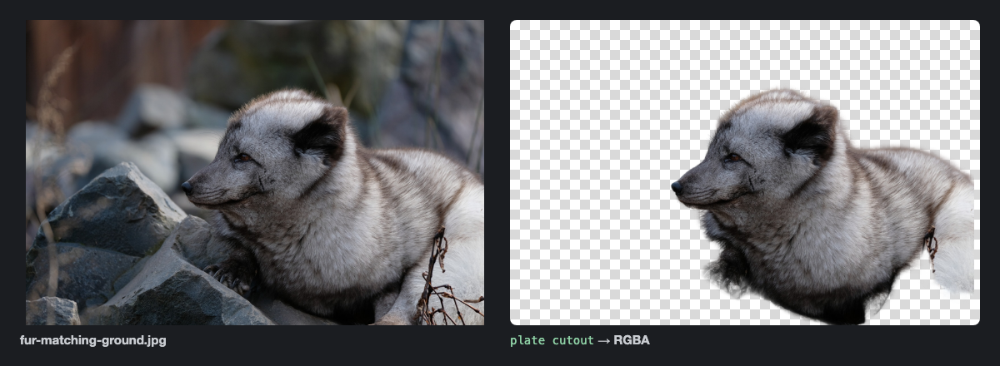

# plate

[](https://github.com/lockyc/plate/releases/latest)


[](LICENSE)

One command for the image, print and render jobs a project keeps redoing: lift a subject out of
a photo, enlarge artwork, make a macOS app icon, render HTML to PNG or PDF, put a flyer two-up on
a sheet for printing, cut a screen recording into a looping demo. Each operation wraps an engine
at a pinned version and is measured against committed test images, so the same input gives the
same output next year.



<sub>Photo: [Musicaline](https://commons.wikimedia.org/wiki/File:Renard_polaire_DSCF2606.jpg), [CC BY-SA 4.0](https://creativecommons.org/licenses/by-sa/4.0/); the cutout is shared under the same licence. Regenerate with [`docs/screenshots/cutout.html`](docs/screenshots/cutout.html).</sub>

## Install

```bash
go install github.com/lockyc/plate@latest
plate doctor --install
```

`plate doctor --install` downloads the engine plate manages itself (chrome-headless-shell, for
every command that renders a page), checks every other engine against its pin, and prints the
install command for any that is missing or too old, naming the commands that won't run until
it's fixed.

`uv` is the only Python tool to install. The ML commands (`cutout`, `inpaint`, `upscale`,
`grade fit`) run through it; the first run of each downloads its dependencies and model
weights — several GB on Linux, where PyTorch ships with CUDA — into those tools' own caches.
They run on the GPU when PyTorch finds one; `PLATE_DEVICE=cpu` (or `mps`, `cuda`) chooses the
device.

## Usage

```bash
plate cutout portrait.jpg subject.png                        # the subject, alpha behind it
plate render --pdf flyer.pdf --png flyer.png --size 792x1120 flyer.html
plate impose -o flyer-2up-a4.pdf flyer.pdf                   # A5 flyer, two-up on A4
plate icon --icns AppIcon.icns tile.svg                      # a macOS app icon
plate build site.manifest                                    # every target, skipping unchanged ones
```

`plate <command> -h` lists each flag with its default.

## Commands

| | Command | Does |
|---|---|---|
| **Images** | `cutout` | Lifts the subject out of an image as RGBA, down to hair and fur |
| | `inpaint` ⚠ | Fills a masked region with LaMa |
| | `infill` ⚠ | Fills a hole in a flat ground, matching the surrounding colour and grain |
| | `upscale` ⚠ | Enlarges 4× with DAT, sharpening existing detail without inventing texture |
| | `grade fit` / `grade apply` | Recovers a reference image's colour grade as a lookup table, and applies it |
| | `shrink` | Resizes down to a small, sharp PNG or WebP, never enlarging |
| | `icon` | A macOS `.icns` and PNGs from a tile, placed in Apple's icon grid |
| | `diff` | Compares two images after lining them up, or two clips frame by frame |
| | `qr` | A QR code SVG any phone camera decodes |
| **Render** | `render` | HTML to PNG, JPEG, PDF or settled HTML with headless Chrome, skipped when nothing changed |
| | `build` | Renders every target in a manifest in parallel |
| | `fonts` | Embeds web fonts into a CSS file, optionally cut to one language's characters |
| | `slides` | Previews a Google Slides deck from its API JSON, one PNG per slide |
| **Print & PDF** | `press` | A print master: text as outlines, CMYK, brand colours exact, checked against a soft proof |
| | `impose` | An A5 flyer two-up on A4, cut down the middle, one- or two-sided |
| | `marks` | A print shop's copy: each page at its trim size with bleed and crop marks |
| | `doc` | Markdown or HTML to a plain A4 PDF with running heads and page numbers |
| | `pdf info` / `text` / `pages` / `images` | Look inside a PDF: metadata, text, pages as PNG, embedded images |
| **Video** | `clip check` / `clip render` | A screen recording and its event log into a short looping demo clip |
| | `animate` | A page's own animation captured frame by frame as MP4, WebM, WebP or GIF |
| **Generate** | `generate` ⚠ / `generate accept` | Rounds of attempts at a character pose from reference images through a hosted image model, each with provenance |
| | `doctor` | Checks every engine against its pin and installs the ones plate manages |

Every command's usage line, and what it writes, refuses and caches:
[docs/commands.md](docs/commands.md). How plate is built: [docs/design.md](docs/design.md).

⚠ `inpaint`, `infill`, `upscale` and `generate` create pixels the source never had. A project
that forbids this puts `synthesis = "forbid"` in a `plate.toml`, and they refuse to run.
`generate` is the only command that needs an API key or spends money, and nothing in a build
can reach it.

## Limits

- **macOS 14 or later on Apple Silicon** runs every command; `clip` and `animate` need ffmpeg at
  its pinned minimum.
- **Linux (glibc 2.28+, x86_64 or arm64)** runs every command except `cutout --coarse vision`,
  which needs Apple Vision; `cutout` uses `--coarse birefnet` there. On arm64, Chrome for
  Testing publishes no chrome-headless-shell, so supply one through
  `PLATE_ENGINE_CHROME_HEADLESS_SHELL`.
- **Intel Macs**: `cutout` and `upscale` refuse to run (PyTorch and ONNX Runtime publish no
  build for them); `grade fit` needs macOS 14 or later; `inpaint` is untested.
- `render` and `animate` run the page outside Chrome's sandbox with open network access: give
  them only pages you trust.

## Status

In use, `0.x`. What's next: [docs/roadmap.md](docs/roadmap.md).

## Development

```bash
git clone https://github.com/lockyc/plate && cd plate
just build    # ./plate
just test
just gate     # gofmt check + vet + tests
just quality  # the quality cases over quality/ (needs every engine and model)
```

The quality cases run plate over the openly licensed and synthetic images in `quality/` and
check each result against a measured threshold. Benchmarks, lockfiles and the release process:
[CLAUDE.md](CLAUDE.md).

## License

MIT — see [LICENSE](LICENSE).
